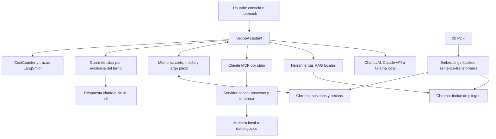
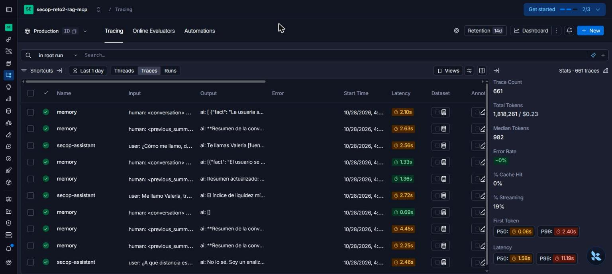
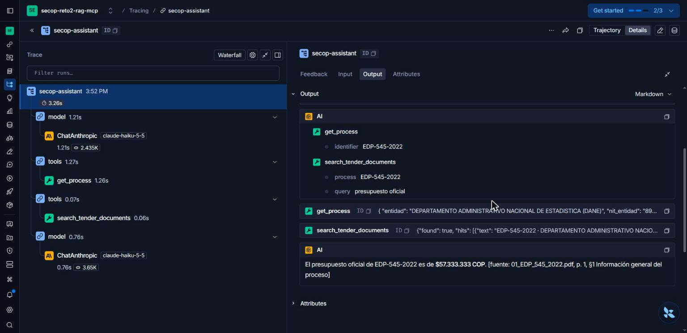
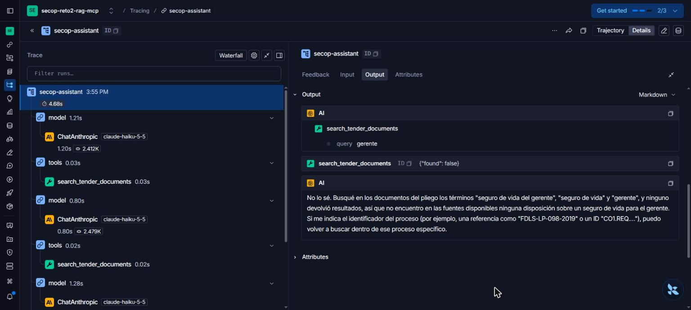
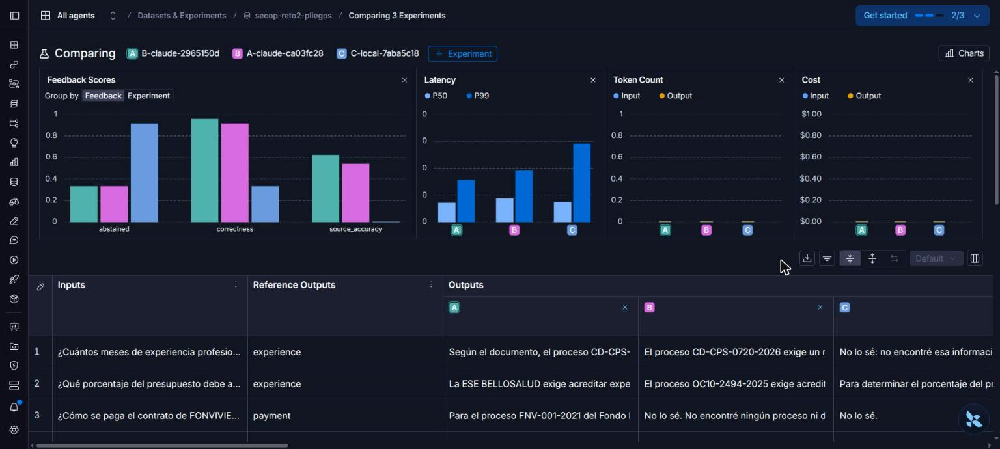

# Reto 2 · Analista SECOP con RAG, MCP y memoria

Entrega de Taller 02: agente en español sobre **20 pliegos simulados con fines educativos**, con citas, herramientas MCP y memoria persistente. Claude Haiku 5.5 es el asistente principal; Qwen 2.5 3B mediante Ollama se compara con el mismo corpus y herramientas.

| Requisito | Implementación / evidencia |
|---|---|
| RAG sobre 20 PDF | 157 fragmentos por sección, metadatos de proceso y citas con página |
| Herramientas por MCP | Cuatro herramientas FastMCP, transporte stdio y configuración VS Code |
| Memoria entre sesiones | Ventana de mensajes, resúmenes y hechos personales en Chroma |
| Respuestas con fuente | Prompt de citas + guard determinista de procedencia |
| «No lo sé» si falta evidencia | Recuperación vacía y guard; casos negativos en pruebas y notebook |
| Precisión y calidad | 24 preguntas × tres configuraciones; extracción de 280 campos |
| Coste, tokens, latencia, trazas | `CostCounter`, identificadores de ejecución y experimentos LangSmith |
| Demostración | [Notebook ejecutado](notebooks/Reto2_SECOP_RAG_MCP_Memoria.ipynb) |



Los **embeddings** los genera localmente `paraphrase-multilingual-MiniLM-L12-v2`. **ChromaDB** almacena/busca vectores y llama a esa función al recibir texto. El **LLM de chat** decide cómo usar herramientas y redacta las respuestas; puede ser remoto o local sin cambiar los embeddings. Detalles en [decisiones de diseño](docs/DESIGN_DECISIONS.md) y [contrato de arquitectura](docs/ARCHITECTURE.md).

## Preparación

Python compatible con `pyproject.toml`, `uv`, acceso a Claude y, para la comparación local, Ollama con `qwen2.5:3b`. La primera instalación del modelo de embeddings requiere descargarlo; en este entorno ya está en caché.

```bash
uv sync
```

Crear `.env` en la raíz con valores propios (no versionarlo):

```dotenv
ANTHROPIC_API_KEY=<clave propia>
MODELO=anthropic:claude-haiku-5-5
MODO_DATOS=muestra
LANGSMITH_API_KEY=<clave propia>
LANGSMITH_TRACING=true
LANGSMITH_PROJECT=secop-reto2-rag-mcp
```

Los scripts cargan `.env` mediante la configuración compartida. No muestran claves. Para usar la caché de embeddings sin buscar descargas:

```bash
HF_HUB_OFFLINE=1 uv run python scripts/build_index.py
uv run python scripts/chat.py
uv run python scripts/chat.py --model ollama:qwen2.5:3b --user-id local-demo
```

Consola: `salir`, `/memoria`, `/olvida <texto>`. La identidad `--user-id` separa la memoria de cada usuario. `/olvida` elimina hechos similares del largo plazo; los resúmenes y mensajes existentes pueden conservar el contenido. No constituye un borrado integral; un hecho puede volver a extraerse de mensajes o resúmenes conservados.

## MCP en VS Code

La configuración [.vscode/mcp.json](.vscode/mcp.json) inicia `uv --directory ${workspaceFolder} run secop-mcp`. Abrir la raíz del proyecto, iniciar el servidor `secop` desde la configuración MCP y habilitar las herramientas en Copilot Chat, modo **Agent**:

- `search_processes`: filtrar procesos.
- `get_process`: consultar una referencia o identificador.
- `get_company_profile`: perfil de la empresa de ejemplo.
- `compute_financial_indicators`: indicadores financieros calculados.

Pedir «Consulta FDLS-LP-098-2019 y cita la fuente» o «Calcula la liquidez de la empresa y cita su archivo». El servidor `memory` de esa configuración usa `npx` y guarda un grafo para Copilot; es independiente de la memoria Chroma del agente Python. El notebook usa además el cliente oficial `mcp.ClientSession` para demostrar el protocolo.

## Evaluaciones y notebook

```bash
HF_HUB_OFFLINE=1 uv run pytest -q
HF_HUB_OFFLINE=1 uv run python scripts/evaluate.py --models anthropic:claude-haiku-5-5 ollama:qwen2.5:3b
HF_HUB_OFFLINE=1 uv run python scripts/evaluate_extraction.py
uv run jupyter lab
uv run jupyter nbconvert --to notebook --execute --inplace --ExecutePreprocessor.timeout=1800 notebooks/Reto2_SECOP_RAG_MCP_Memoria.ipynb
```

`evaluate.py` compara B-Claude (guard), A-Claude (prompt) y C-local (guard). La corrección la juzga Claude con salida estructurada; su coste se separa del agente. La precisión de fuente exige el PDF esperado; una respuesta factual correcta desde MCP puede fallar esa métrica. Abstención se mide en 8 preguntas ausentes; falsas abstenciones y fuente, en 16 respondibles. Cada pregunta tiene memoria temporal e identidad aisladas. Errores operativos cuentan como incorrectos.

Los resultados JSON/Markdown se guardan en `resultados/`. Los checkpoints evitan repetir llamadas ya medidas; `--force` las repite y genera gasto. Si cambia el agente, el retriever o el protocolo experimental, hay que invalidar deliberadamente los checkpoints y guardar una ejecución nueva. Con clave LangSmith se publica `secop-reto2-pliegos` y un experimento por configuración, usando las respuestas ya medidas. Cada resultado conserva el `run_id` de su traza original.

La extracción compara catorce campos por PDF con `datos/clave_aptitud.json`; la clave solo interviene al puntuar. Puede solicitarse extracción local con `--models ollama:qwen2.5:3b`. Esa comparación adicional no forma parte de la ejecución entregada.

<!-- RESULTS:START -->
## Resultados medidos

| Configuración | Corrección | Fuente | Abstención (8) | Falsa abstención (16) | USD agente + memoria | USD juez | Latencia media s |
|---|---:|---:|---:|---:|---:|---:|---:|
| B-claude | 95.83% | 93.75% | 100.00% | 0.00% | 0.035452 | 0.003996 | 5.04 |
| A-claude | 91.67% | 81.25% | 87.50% | 6.25% | 0.036906 | 0.003826 | 5.16 |
| C-local | 33.33% | 0.00% | 100.00% | 87.50% | 0.000000 | 0.003683 | 2.23 |

**Extracción Claude: 279/280 campos (99,64 %), USD 0,009803**, 55.865 tokens de entrada, 8.435 de salida y 116,19 s. La extracción no se volvió a medir; se reutilizaron sus checkpoints. El desacuerdo sigue siendo `experience_by_similar_object` en `02_CD_55_2021_3516.pdf`. La extracción local adicional se omitió.

Se recomienda **B-Claude** para esta entrega: obtuvo **23/24** respuestas correctas, 15/16 fuentes esperadas y ocho abstenciones correctas. Su único fallo, q05, comienza «Sí» y luego afirma «no se exige» la constitución de garantías: se conserva como respuesta contradictoria e incorrecta. A-Claude obtuvo **22/24**: q10 fue una falsa abstención y q20 agotó el límite de pasos con respuesta vacía. Una sola ejecución no demuestra una mejora causal del guard.

C-local obtuvo **8/24**, los ocho casos ausentes; falló los 16 respondibles, con 14 falsas abstenciones (87,50 %) y dos respuestas incorrectas sin el prefijo de abstención. Una calculó un porcentaje ajeno al requisito (q08); otra alegó falta de datos con cita MCP (q09). No acertó ninguna fuente PDF. Su latencia media de **2,23 s** y coste por token cero no compensan la calidad observada. Solo se evaluó Qwen 2.5 3B con este prompt y estas herramientas.

La ejecución vigente no contiene revisiones dirigidas del juez (`judge_audits: []`).

Resultados completos: [RAG](resultados/evaluacion_rag.md), [extracción](resultados/extraccion_requisitos.md).
<!-- RESULTS:END -->

El coste local por token es cero según `secop_agent.costs`; no incluye energía ni hardware. Los costes Claude usan la tabla del proyecto, no una factura conciliada. El fixture también se usó para calibrar la recuperación: una nota alta aquí no mide generalización a pliegos nuevos.

## Evidencias LangSmith

[Mediciones y trazas verificadas](resultados/evidencia_langsmith.md): estadísticas del proyecto, comparación con CostCounter y enlaces a los tres experimentos y a las trazas originales. Regenerar con `uv run python scripts/langsmith_evidence.py`; requiere acceso a LangSmith y no llama al LLM. Los experimentos publican salidas desde checkpoints: su latencia de publicación no mide inferencia. Las trazas originales muestran el consumo del agente.

Capturas tomadas de la interfaz de LangSmith el 28/10/2026 (detalle en [docs/evidencias](docs/evidencias/README.md)):

**Proyecto `secop-reto2-rag-mcp`:** 661 trazas, 1.818.261 tokens, USD 0,23 y latencia P50 1,58 s / P99 11,19 s, con la latencia de cada ejecución.



**Traza con cita:** el agente llama a `get_process` (servidor MCP) y a `search_tender_documents` (RAG) y responde «$57.333.333 COP» citando `01_EDP_545_2022.pdf, p. 1, §1`. Se ven los tokens de cada llamada a Claude.



**Traza «No lo sé»:** tres búsquedas devuelven `{"found": false}` y el agente se abstiene.



**Comparación de experimentos** (A = B-claude, B = A-claude, C = C-local): corrección, precisión de fuente y tasa de abstención por configuración, y las respuestas lado a lado. Las gráficas de tokens y coste de esta vista salen en cero porque los experimentos se publicaron desde checkpoints; el consumo real está en las trazas originales y en [evidencia_langsmith.md](resultados/evidencia_langsmith.md).



## Estructura

```text
datos/                         PDF simulados, muestra, empresa y clave
datasets/tender_questions.json  16 preguntas respondibles y 8 ausentes
src/secop_agent/                configuración, LLM, costes y embeddings
  rag/                         carga, índice y recuperación
  memory/                      corto, medio, largo plazo y manager
  extraction.py                extracción estructurada y puntuación
  agent.py                     integración asíncrona y métricas
  grounding.py                 validación determinista de citas
src/secop_mcp/                 servidor y herramientas de contratación
scripts/                       índice, consola y evaluaciones
notebooks/                     demostración ejecutada
tests/                         pruebas con LLM falsos, sin claves
docs/                          contrato y decisiones
resultados/                    resultados medidos
almacen/ y memoria/             persistencia local, excluida de Git
```

El guard confirma la procedencia de las etiquetas, no la veracidad de cada frase. El prompt solicita citar cada frase factual; no existe un verificador semántico independiente por frase. Documentos, herramientas y memoria se tratan como datos, nunca instrucciones. Estas restricciones y el alcance del olvido están descritos en las decisiones de diseño.
